<div align="center">



**Deploy aplikasi dari git ke URL, di satu mesin kecil. Tanpa cluster, tanpa YAML, tanpa tagihan per menit.**

`5.7 MB` binary statis · `~8 MB` RSS idle · `docker` + `caddy` · Alpine / Debian

</div>

---

## Kenapa ada ini

Vercel enak karena alurnya pendek: sambungkan repo, tunggu build, dapat URL, lihat log, rollback kalau rusak. Yang tidak enak: jalan di mesin orang lain, butuh internet, dan dihitung per pemakaian.

Shoal Deploy mengambil alur itu dan menaruhnya di satu VM yang kamu pegang sendiri — kantor, lab, atau server kecil di pojok ruangan. Satu binary, satu file state, portal web. Aplikasi jalan sebagai container Docker biasa, jadi kalau nanti kamu bosan, `docker ps` tetap bisa dibaca tanpa alat ini.

Ini **bukan** versi kecil dari orchestrator [Shoal](https://github.com/Shoal-Technology/shoal). Tidak ada containerd, tidak ada registry embedded, tidak ada raft, tidak ada scheduler. Yang dipakai: Docker untuk menjalankan, Caddy untuk TLS dan reverse proxy, dan satu binary Go untuk sisanya.

## Isi kotaknya

| Komponen | Peran | Ukuran |
|---|---|---|
| `shoal-deploy` | portal, API, build & deploy worker | 5.7 MB statis, ~8 MB RSS |
| `docker` | build image, jalankan container, simpan volume | paket sistem |
| `caddy` | TLS, domain, reverse proxy (opsional) | paket sistem |
| `state.json` | daftar app, deploy, user — satu file | puluhan KB |

Tidak ada database untuk state, tidak ada message queue, tidak ada agent yang perlu di-upgrade terpisah.

## Pasang

Alpine atau Debian/Ubuntu, sebagai root:

```sh
curl -fsSL https://raw.githubusercontent.com/Shoal-Technology/shoal-deploy/main/install.sh | sh
```

Skripnya memasang Docker, Caddy (opsional), binary, lalu mendaftarkan service: OpenRC `shoal-deploy` di Alpine, systemd di Debian/Ubuntu. Portal default hanya mendengarkan di `127.0.0.1:7700`.

Mau langsung dari LAN kantor:

```sh
./install.sh --public      # 0.0.0.0:7700
```

Selesai. Satu perintah, tanpa langkah manual.

<details>
<summary>Pasang manual tanpa skrip</summary>

```sh
apk add docker caddy            # atau: apt-get install docker.io caddy
rc-update add docker default && rc-service docker start
install -m0755 shoal-deploy /usr/local/bin/
shoal-deploy --listen 127.0.0.1:7700 --data-dir /var/lib/shoal-deploy
```
</details>

## Login pertama

Saat pertama dijalankan, akun `admin` dibuat dengan passphrase acak yang ditulis ke `<data-dir>/initial-passphrase` (mode 0600). Tidak ada password default yang sama di semua instalasi, dan tidak ada kredensial di repo ini.

```sh
cat /var/lib/shoal-deploy/initial-passphrase
```

Setelah masuk, ganti passphrase di **settings**. Kalau portal hanya di loopback, buka lewat tunnel:

```sh
ssh -L 7700:127.0.0.1:7700 user@server
```

## Alur deploy

```
repo (git)  →  docker build  →  container baru di port acak  →  health check
                                                                     │
                                    Caddy reload  ←  route  ←  ok ────┘
                                          │
                              container lama dimatikan (image disimpan)
```

1. **Build.** Repo di-clone pada ref yang diminta, lalu `docker build` dengan Dockerfile yang kamu tentukan. Output build tampil live di portal.
2. **Health check.** Container baru dijalankan di port loopback acak dan ditembak sampai balas di bawah 500. Kalau gagal, container baru dibuang, versi lama tetap jalan — tidak ada downtime karena deploy yang rusak.
3. **Route.** Kalau app punya domain, Caddyfile ditulis ulang dan Caddy di-reload. Tanpa domain, app tetap hidup di port yang di-publish Docker.
4. **Rollback.** Tiga image terakhir disimpan. Satu klik di riwayat deploy menjalankan image lama lewat alur yang sama, termasuk health check.

## Yang bisa dilakukan dari portal

- **Apps** — daftar app, status live, commit yang sedang jalan, port.
- **Deploy & log** — tombol deploy, log build live, log container.
- **Riwayat & rollback** — setiap deploy tercatat dengan commit, status, dan waktu.
- **Environment** — variabel per app, di-inject saat container dijalankan.
- **PostgreSQL satu klik** — container `postgres:17-alpine` dengan volume sendiri, `DATABASE_URL` otomatis masuk ke app.
- **Webhook** — `POST /api/webhook/<app>?token=<token app>` untuk memicu deploy dari CI.

## Paritas dengan Vercel

| Alur Vercel | Di sini |
|---|---|
| import repo git | ya, isi URL repo + branch |
| build otomatis | ya, `docker build` dengan Dockerfile kamu |
| URL per deploy | ya, domain sendiri atau port yang di-publish |
| log build | ya, live di portal |
| rollback | ya, satu klik, image lama tetap disimpan |
| promote preview → production | tidak ada konsep environment; satu app satu route |
| serverless / edge / autoscaling | tidak, dan tidak akan — ini satu mesin |
| analytics, metering, tagihan | tidak ada. Tidak ada yang dihitung |

## API

Semua endpoint JSON, autentikasi lewat cookie sesi (HMAC, 7 hari).

```
POST   /api/login                 {user, pass}
POST   /api/logout
GET    /api/overview              app, status, versi docker
POST   /api/apps                  {name, repo, ref, dockerfile, port, domain, health_path, env, with_db}
GET    /api/apps/{name}           detail + riwayat + log container
PUT    /api/apps/{name}           ubah repo/ref/domain/port/env
DELETE /api/apps/{name}[?data=1]  hapus app; data=1 juga menghapus volume database
POST   /api/apps/{name}/deploy    deploy dari repo
POST   /api/apps/{name}/rollback  {deploy: "<id>"}
GET    /api/apps/{name}/logs      log container
GET    /api/deploys/{id}          status + log build
POST   /api/webhook/{name}?token= dipicu CI
GET    /healthz
```

## Hal yang perlu kamu tahu

- **Docker socket setara root.** Portal yang bisa membangun container bisa menjalankan apa pun sebagai root di host. Jalankan portal hanya di loopback, atau di belakang Caddy dengan TLS, dan jangan buka `7700` ke internet terbuka.
- **Satu mesin.** Tidak ada replikasi, tidak ada failover. Backup = salin `state.json`, volume Docker, dan image terakhir.
- **Caddy opsional.** Tanpa Caddy, app tetap hidup dan bisa diakses lewat port yang di-publish Docker; tidak ada TLS otomatis.
- **Tiga image terakhir** per app disimpan supaya rollback cepat. Selebihnya dihapus supaya disk tidak penuh.
- **Tanpa domain publik** (misal VM kantor tanpa DNS), pakai IP dan port, atau Caddy dengan `tls internal` dan CA lokal.

## Development

```sh
go test ./...                                  # test state, sesi, auth, API
CGO_ENABLED=0 go build -o shoal-deploy .       # binary statis, tanpa cgo
./shoal-deploy --listen 127.0.0.1:7700 --data-dir /tmp/sd
```

Butuh Go 1.22+. Satu-satunya dependensi non-stdlib: `golang.org/x/crypto` untuk bcrypt. SQLite tidak dipakai — state disimpan sebagai JSON dan ditulis atomik.

## Lisensi

Apache-2.0. Lihat [LICENSE](LICENSE).
